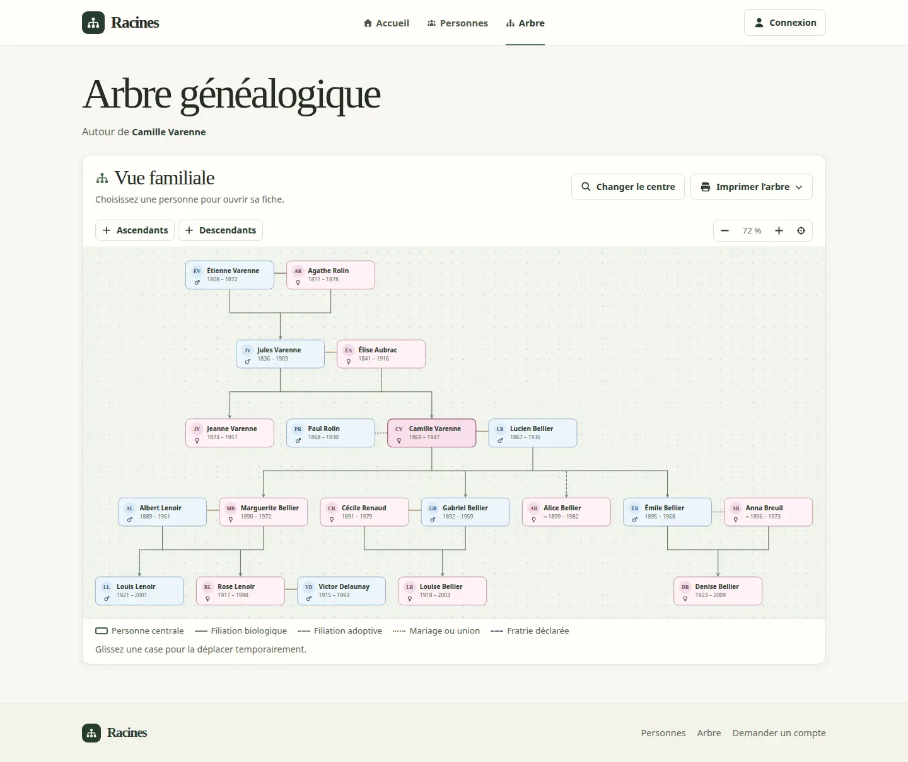

# Racines

Racines est un wiki généalogique en français. Les visiteurs peuvent rechercher une personne, parcourir les liens familiaux et consulter toutes les fiches, photos et pièces d’archives. Les administrateurs peuvent modifier les fiches et les relations et gérer les comptes.

## Démarrage local

Prérequis sous Linux

- PHP 8.3 ou plus récent avec PDO SQLite, DOM, Fileinfo et Mbstring.
- ImageMagick avec les décodeurs JPEG, PNG, WebP, AVIF, HEIC et BMP, et l’encodeur WebP. Vérifier leur présence avec `convert -list format` ou `magick -list format`.
- SQLite est fourni par l’extension PHP. Le projet utilise directement le PHP, le CSS et le JavaScript du dépôt.

### Vérifier les prérequis

Sur Debian et Ubuntu, si la commande `php` manque, installer d’abord le paquet `php-cli` et vérifier avec `php -v` que la version fournie est au moins 8.3. Lancer ensuite le diagnostic depuis le projet.

~~~sh
php bin/console.php check
~~~

Le rapport liste les extensions PHP et les formats annoncés par ImageMagick. Il affiche les installations ou réglages proposés et renvoie `1` quand un contrôle échoue. Sous Debian et Ubuntu, il propose une commande `sudo apt install` lorsque des paquets peuvent résoudre le problème.

Pour une installation Nginx, vérifier aussi le serveur, la version de PHP-FPM et ses extensions.

~~~sh
php bin/console.php check --production
~~~

Le diagnostic examine le binaire PHP-FPM installé. Les paramètres du pool utilisé par Nginx se vérifient dans la configuration de production.

### Lancer la démonstration

Depuis ce dossier, créer une base de démonstration et lancer le serveur PHP.

~~~sh
php bin/console.php demo
php -d upload_max_filesize=12M -d post_max_size=16M -S 127.0.0.1:8000 -t public
~~~

Ouvrir [Racines en local](http://127.0.0.1:8000). La démo crée 26 personnes fictives avec du Lorem ipsum, six portraits illustratifs et une pièce PDF d’exemple. L’illustration de l’accueil et les portraits dérivés sont générés. Pour démarrer avec une base vide, utiliser `php bin/console.php init` à la place de `demo`.

## Consultation et édition

- Les administrateurs modifient directement les champs de la fiche, la biographie et les faits notables. Les boutons « Enregistrer les modifications » en haut et en bas valident la saisie et enregistrent tous les champs de la fiche en une fois.
- Une fiche peut être créée avec des champs vides. Les informations manquantes et les personnes sans lien apparaissent dans **À renseigner ultérieurement**, accessible aux administrateurs dans l’en-tête. Chaque tâche ouvre le champ correspondant ou le bouton d’ajout de relation. Cliquer sur **Ignorer** écarte la tâche des prochains balayages.
- La case **Décédée** affiche la date et le lieu de décès. Ces champs entrent dans les tâches uniquement pour les personnes marquées décédées. Enregistrer une fiche comme vivante retire ses informations de décès de la fiche et garde les anciennes valeurs dans l’historique.
- La recherche combine le nom ou prénom et l’année de naissance ou de décès. Les dates peuvent être complètes, réduites à l’année, qualifiées par « vers », « avant » ou « après », ou laissées vides.
- Une famille correspond à un groupe distinct de parents qui ont au moins un enfant renseigné. Plusieurs enfants du même groupe comptent pour une seule famille. Les frères et sœurs sont déduits des parents communs.
- L’arbre affiche deux générations de part et d’autre de la personne centrale au départ. Les boutons « Ascendants » et « Descendants » ajoutent des générations. Chaque case ouvre une fiche. On peut zoomer, déplacer la vue et déplacer temporairement les cases. La mise en page privilégie les liens lisibles et réduit les croisements.
- Dans l’arbre, l’annuaire et l’activité récente, les cartes sont roses pour les femmes, bleues pour les hommes et neutres quand le sexe reste à renseigner. Le symbole apparaît sous l’avatar. Le champ « Sexe » se modifie sur la fiche.
- Le symbole du sexe apparaît aussi devant les prénoms dans la section « Relations ». Le menu de l’arbre propose « Créer un conjoint » pour une union et « Créer un mari ou une femme » pour un mariage. Le sexe opposé est présélectionné quand le sexe de la personne de référence est connu. Le choix est modifiable.
- Le clic droit, l’appui prolongé ou `Maj` + `F10` ouvrent le menu de la case ou du lien sélectionné. Les administrateurs peuvent y modifier un lien, supprimer une fiche ou créer un père, une mère, un enfant biologique ou adoptif, un frère ou une sœur. Créer un membre de la fratrie reprend les filiations connues. Si les parents sont inconnus, le site enregistre un lien de fratrie direct.
- Les administrateurs modifient les liens en cliquant dessus ou en passant par la section « Relations ». Pour ajouter un lien, ils peuvent choisir les deux personnes dans le formulaire ou sélectionner les deux cases dans le graphique. Une année de fin signale une union terminée.
- Lorsqu’un parent a un seul partenaire actuel, en union ou en mariage, créer un enfant ou ajouter une filiation crée aussi le lien biologique ou adoptif pour ce partenaire. Chaque filiation peut être retirée séparément depuis le menu de l’arbre. Avec plusieurs partenaires, l’autre filiation s’ajoute manuellement.
- La fiche et l’arbre s’impriment séparément. Le menu de l’arbre propose la vue affichée, la branche ascendante intégrale, la branche descendante intégrale et les deux branches intégrales.
- **Ajouter une photo** ouvre le sélecteur de fichiers. Les photos de 10 Mo maximum sont envoyées dès leur sélection et converties en WebP avec un grand côté de 2 000 pixels, orientation appliquée et métadonnées retirées. Les documents PDF et JPEG peuvent atteindre 12 Mo par fichier.
- La galerie affiche les photos entières et adapte leur largeur en conservant leurs proportions.
- L’éditeur qui s’ouvre après l’envoi permet de changer le titre, d’ajuster le cadre de la photo et de préparer un médaillon avec le cercle ou les curseurs. **Enregistrer** remplace le WebP par la zone recadrée et applique le médaillon choisi. Le lien **Modifier la photo** dans la galerie permet de revenir à cet éditeur. La croix sur la fiche ou le bouton **Retirer le médaillon** dans l’éditeur retire le médaillon et conserve la photo.
- Les modifications sont datées et attribuées à leur auteur. Un administrateur peut supprimer une fiche ou fusionner des doublons. La fusion conserve les champs renseignés de la fiche principale et récupère les informations manquantes, les médias, les liens et l’historique de l’autre fiche.

### Comptes administrateurs

Créer le premier compte administrateur depuis le terminal. La commande demande le mot de passe et le stocke sous forme de hachage salé.

~~~sh
php bin/console.php admin 'Prénom' 'Nom' 'mainteneur@example.test'
~~~

La personne choisit et confirme son mot de passe dans le formulaire de demande, puis répond à un CAPTCHA de calcul. La demande est placée en attente. Une fois validée, elle donne accès à tous les droits d’administration avec l’adresse et le mot de passe choisis dans le formulaire.

Le lien **Gestion des comptes** apparaît dans l’en-tête pour les administrateurs. Cette page permet de valider ou de refuser les demandes, ainsi que d’ajouter, de modifier ou de supprimer des comptes. Pour le premier compte administrateur, seul son titulaire peut le modifier ou le supprimer. Si le dernier administrateur se supprime, la commande `php bin/console.php admin` permet de créer un nouveau compte.

La mise à jour applique les migrations SQLite à la première ouverture de la base. Pour les appliquer depuis le terminal, lancer `php bin/console.php init`. Les anciens comptes éditeurs actifs repassent en attente de validation et les administrateurs existants devront se reconnecter. Un ancien lien d’invitation valide permet encore de choisir un mot de passe avant validation. Un administrateur peut aussi définir ce mot de passe depuis la gestion des comptes.

### Balayer les fiches existantes

~~~sh
php bin/console.php todo
~~~

La commande complète la liste pour les fiches existantes et indique le nombre de personnes sans lien et de tâches ajoutées. Tu peux la relancer. Les tâches déjà présentes et les choix d’ignorer un champ sont conservés.

## Configuration de production

1. Copier `config/local.example.php` vers `config/local.php`. Régler l’URL HTTPS publique et le chemin du répertoire de données. Choisir `magick` si la commande d’ImageMagick 7 est disponible.
2. Adapter [le fichier d’exemple Nginx](config/nginx.conf.example) à son domaine, son répertoire `public/` et sa version de PHP-FPM. Configurer HTTPS sur le serveur et fixer `upload_max_filesize` à `12M` et `post_max_size` à `16M` côté PHP-FPM.
3. Donner à l’utilisateur PHP-FPM l’accès en écriture au répertoire de données et en lecture au code. Exécuter les commandes `init` et `admin` avec ce même accès. Les variables d’environnement `GENEALOGY_DATA_DIR` et `GENEALOGY_APP_URL` permettent de lancer une instance séparée.
4. Sauvegarder SQLite avec l’outil de sauvegarde de SQLite ou à l’arrêt du site. La base contient les fiches, les comptes, l’historique et les médias.

Les données d’exécution, la configuration locale, les archives d’origine et le cahier des charges local sont ignorés par Git. Le dossier `incoming/` peut accueillir les sources privées à traiter séparément.

## Organisation

- `public/` contient le point d’entrée PHP et les fichiers accessibles au navigateur.
- `app/` contient les règles métier, le schéma SQLite et les données fictives du mode démo.
- `views/` contient les gabarits HTML.
- `bin/console.php` vérifie les prérequis, initialise la base et crée des comptes administrateurs.

Les icônes de l’interface sont une sélection d’icônes SVG de Font Awesome Free 7.3.1 par Fonticons, Inc., distribuées sous licence CC BY 4.0. Les tracés d’origine sont regroupés dans `public/assets/fontawesome.svg` et servis avec le site. [Font Awesome Free](https://fontawesome.com/license/free), [licence CC BY 4.0](https://creativecommons.org/licenses/by/4.0/).

Illustration de démonstration

Image générée avec ImageGen et enregistrée sous [archives-fictives.webp](public/assets/archives-fictives.webp).

> Create a wide landscape hero background photograph for a refined French genealogy archive website, no text whatsoever. Convincing fictitious late-19th-century French historical family photograph, circa 1895, in faded warm sepia. A multigenerational family of six, grandparents and parents with two children, dressed in period-accurate dark wool, standing and seated in front of the exterior plaster and stone wall of a rural French family home. Gentle, serious expressions and natural posture, soft overcast daylight. Place the people mainly in the right two-thirds, with some dark atmospheric empty area at left. Keep faces between middle and upper middle of image, comfortably inside crop. Film grain, slightly worn gelatin print surface, paper texture, faded corners, one softly dark vignette, quiet and understated authentic archival feeling. Edge-to-edge crop, no individual photo frame, no collage, no illustrated elements, no logos, no modern objects, no annotations.

