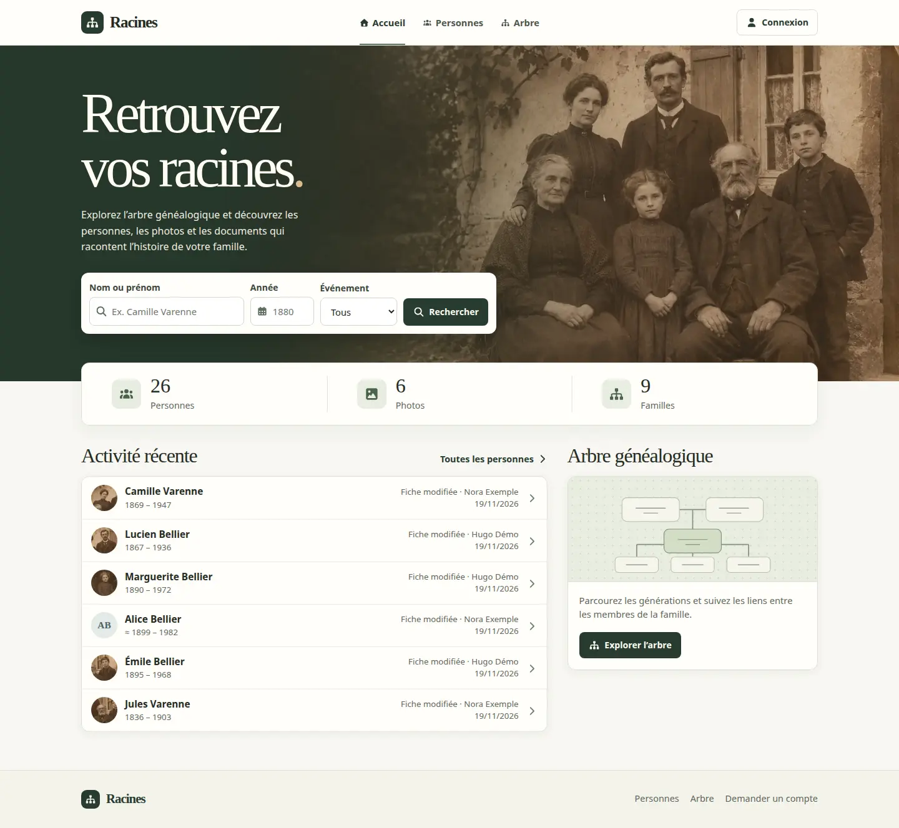
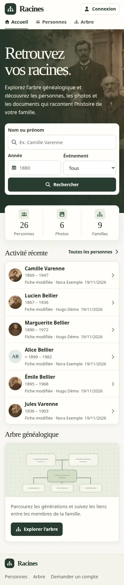

# Racines

Racines est un wiki généalogique en français. Les visiteurs peuvent rechercher une personne, parcourir les liens familiaux et consulter toutes les fiches, photos et pièces d’archives. Les éditeurs validés peuvent enrichir les fiches et corriger les relations.

## Démarrage local

Prérequis sous Linux

- PHP 8.3 ou plus récent avec PDO SQLite, DOM, Fileinfo et Mbstring.
- ImageMagick avec les décodeurs JPEG, PNG, WebP, AVIF, HEIC et BMP, et l’encodeur WebP. Vérifier leur présence avec `convert -list format` ou `magick -list format`.
- SQLite est fourni par l’extension PHP. Le projet utilise directement le PHP, le CSS et le JavaScript du dépôt.

Depuis ce dossier, créer une base de démonstration et lancer le serveur PHP.

~~~sh
php bin/console.php demo
php -d upload_max_filesize=12M -d post_max_size=16M -S 127.0.0.1:8000 -t public
~~~

Ouvrir [Racines en local](http://127.0.0.1:8000). La démo crée 26 personnes fictives avec du Lorem ipsum, six portraits illustratifs et une pièce PDF d’exemple. L’illustration de l’accueil et les portraits dérivés sont générés. Pour démarrer avec une base vide, utiliser `php bin/console.php init` à la place de `demo`.

## Consultation et édition

- La recherche combine le nom ou prénom et l’année de naissance ou de décès. Les dates peuvent être complètes, réduites à l’année, qualifiées par « vers », « avant » ou « après », ou laissées vides.
- Une famille correspond à un groupe distinct de parents qui ont au moins un enfant renseigné. Plusieurs enfants du même groupe comptent pour une seule famille. Les frères et sœurs sont déduits des parents communs.
- L’arbre affiche deux générations de part et d’autre de la personne centrale au départ. Les boutons « Ascendants » et « Descendants » ajoutent des générations. Chaque case ouvre une fiche. On peut zoomer, déplacer la vue et déplacer temporairement les cases. La mise en page privilégie les liens lisibles et réduit les croisements.
- Dans l’arbre, l’annuaire et l’activité récente, les cartes sont roses pour les femmes, bleues pour les hommes et neutres quand le sexe reste à renseigner. Le symbole apparaît sous l’avatar. Le champ « Sexe » se modifie sur la fiche.
- Le symbole du sexe apparaît aussi devant les prénoms dans la section « Relations ». Le menu de l’arbre propose « Créer un conjoint » et présélectionne le sexe opposé quand le sexe de la personne de référence est connu. Le choix est modifiable. Le lien créé est une union.
- Le clic droit, l’appui prolongé ou `Maj` + `F10` ouvrent le menu de la case ou du lien sélectionné. Les éditeurs peuvent y modifier un lien ou créer un père, une mère, un enfant biologique ou adoptif, un frère ou une sœur. Créer un membre de la fratrie reprend les filiations connues. Si les parents sont inconnus, le site enregistre un lien de fratrie direct. Le mainteneur peut aussi supprimer une fiche depuis l’arbre.
- Les éditeurs modifient les liens en cliquant dessus ou en passant par la section « Relations ». Pour ajouter un lien, ils peuvent choisir les deux personnes dans le formulaire ou sélectionner les deux cases dans le graphique. Une année de fin signale une union terminée.
- La fiche et l’arbre s’impriment séparément. Le menu de l’arbre propose la vue affichée, la branche ascendante intégrale, la branche descendante intégrale et les deux branches intégrales.
- Les photos de fiche sont converties en WebP avec un grand côté de 2 000 pixels, orientation appliquée et métadonnées retirées. Les pièces PDF et JPEG sont téléchargeables. La limite est de 12 Mo par fichier.
- La galerie affiche les photos entières et adapte leur largeur en conservant leurs proportions.
- Après l’envoi d’une photo, l’éditeur peut cadrer un médaillon à l’aide du cercle ou des curseurs. Le médaillon sert d’avatar dans l’arbre et dans la liste des personnes. Le cadrage reste modifiable depuis les photos de la fiche.
- Les modifications sont datées et attribuées à leur éditeur. Le mainteneur peut supprimer une fiche ou fusionner des doublons. La fusion conserve les champs renseignés de la fiche principale et récupère les informations manquantes, les médias, les liens et l’historique de l’autre fiche.

### Comptes éditeurs

Créer le compte du mainteneur depuis le terminal. La commande demande le mot de passe et le stocke sous forme de hachage salé.

~~~sh
php bin/console.php admin 'Prénom' 'Nom' 'mainteneur@example.test'
~~~

Après une demande de compte, le mainteneur reçoit un lien à usage unique qui ouvre les boutons de décision. En cas de validation, la personne reçoit un second lien pour choisir son mot de passe. Les liens expirent après trois jours et les comptes validés ont accès à l’édition de toutes les fiches.

Avec la configuration locale par défaut, les messages sont enregistrés dans `var/outbox/` au format `.eml`. Ouvrir le dernier message destiné au mainteneur, puis celui destiné à l’éditeur pour tester le parcours sur sa machine.

## Configuration de production

1. Copier `config/local.example.php` vers `config/local.php`. Régler l’URL HTTPS publique et le chemin du répertoire de données. Choisir `magick` si la commande d’ImageMagick 7 est disponible.
2. Adapter [le fichier d’exemple Nginx](config/nginx.conf.example) à son domaine, son répertoire `public/` et sa version de PHP-FPM. Configurer HTTPS sur le serveur et fixer `upload_max_filesize` à `12M` et `post_max_size` à `16M` côté PHP-FPM.
3. Donner à l’utilisateur PHP-FPM l’accès en écriture au répertoire de données et en lecture au code. Exécuter les commandes `init` et `admin` avec ce même accès. Les variables d’environnement `GENEALOGY_DATA_DIR` et `GENEALOGY_APP_URL` permettent de lancer une instance séparée.
4. Quand un agent d’envoi est disponible, régler `mail_mode` sur `mail` et renseigner `mail_from`. PHP transmet les messages à l’agent d’envoi du serveur ou à son relais SMTP. Le mode `outbox` garde les messages sur le serveur.
5. Sauvegarder SQLite avec l’outil de sauvegarde de SQLite ou à l’arrêt du site. La base contient les fiches, les comptes, l’historique et les médias.

Les données d’exécution, la configuration locale, les archives d’origine et le cahier des charges local sont ignorés par Git. Le dossier `incoming/` peut accueillir les sources privées à traiter séparément.

## Organisation

- `public/` contient le point d’entrée PHP et les fichiers accessibles au navigateur.
- `app/` contient les règles métier, le schéma SQLite et les données fictives du mode démo.
- `views/` contient les gabarits HTML.
- `bin/console.php` initialise la base et crée le compte du mainteneur.

Les icônes de l’interface sont une sélection d’icônes SVG de Font Awesome Free 7.3.1 par Fonticons, Inc., distribuées sous licence CC BY 4.0. Les tracés d’origine sont regroupés dans `public/assets/fontawesome.svg` et servis avec le site. [Font Awesome Free](https://fontawesome.com/license/free), [licence CC BY 4.0](https://creativecommons.org/licenses/by/4.0/).

Illustration de démonstration

Image générée avec ImageGen et enregistrée sous [archives-fictives.webp](public/assets/archives-fictives.webp).

> Create a wide landscape hero background photograph for a refined French genealogy archive website, no text whatsoever. Convincing fictitious late-19th-century French historical family photograph, circa 1895, in faded warm sepia. A multigenerational family of six, grandparents and parents with two children, dressed in period-accurate dark wool, standing and seated in front of the exterior plaster and stone wall of a rural French family home. Gentle, serious expressions and natural posture, soft overcast daylight. Place the people mainly in the right two-thirds, with some dark atmospheric empty area at left. Keep faces between middle and upper middle of image, comfortably inside crop. Film grain, slightly worn gelatin print surface, paper texture, faded corners, one softly dark vignette, quiet and understated authentic archival feeling. Edge-to-edge crop, no individual photo frame, no collage, no illustrated elements, no logos, no modern objects, no annotations.

